# Oi, eu sou o Murilo

<picture>
  <source media="(prefers-color-scheme: dark)" srcset="https://readme-typing-svg.demolab.com?font=Fira+Code&size=18&pause=1000&center=true&vCenter=true&width=460&color=FFFFFF&lines=backend+com+Java+e+Spring+Boot;Node.js+%7C+TypeScript+%7C+PostgreSQL;cofundador+da+Thera">
  
</picture>
 

Desenvolvedor backend e estudante de Engenharia da Computação na UEMA. Cofundador e Diretor de P&D da [Thera](https://github.com/thera-org), onde construo APIs, sistemas multi-tenant e o que mais precisar ir para produção.

---

### O que eu construí

- **Projeto FAB**: sistema de gestão da Escola Caminho das Estrelas, no Centro de Lançamento de Alcântara (Spring Boot, Keycloak, Next.js)
- **thera-core**: kernel multi-tenant da Thera, com identidade, RBAC e isolamento por Row Level Security (Spring Boot, PostgreSQL)
- **NeoLab**: gestão dos laboratórios da UEMA, usada por mais de 50 alunos (Node.js, React)
- [**LumaBot**](https://github.com/murillous/LumaBot): bot de WhatsApp com IA, figurinhas e lembretes
- [**Bridger**](https://github.com/murillous/usebridger): framework de bots de mensageria publicado no npm
- [**agronomia-API**](https://github.com/murillous/agronomia-API): dados abertos da estação meteorológica da UEMA

---

### Com o que eu trabalho

---

### Onde me encontrar

---

<picture>
  <source media="(prefers-color-scheme: dark)" srcset="https://raw.githubusercontent.com/murillous/murillous/output/pacman-contribution-graph-dark.svg">
  <source media="(prefers-color-scheme: light)" srcset="https://raw.githubusercontent.com/murillous/murillous/output/pacman-contribution-graph.svg">
  
</picture>

